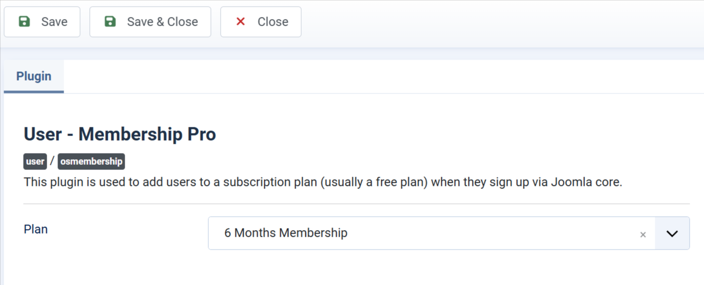

This plugin is used to subscribe users automatically to a selected subscription when they register for a Joomla user account (via Joomla users registration or when a user account is created manually by administrator)

If you want to use these features, please follow the steps below:

1. Go to **System** -> **Plugins**, find and enable the plugin **User - Membership Pro**
2. Select the subscription plan users will be subscribed to automatically when Joomla user account created for him in the **Plan** parameter.

