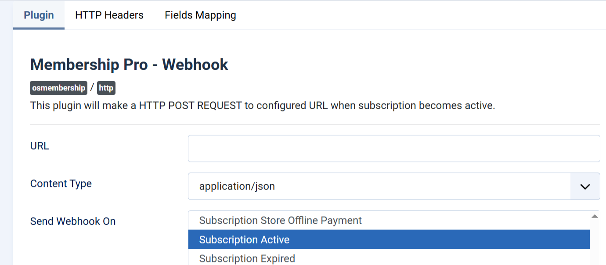

This plugin gives you a way to send subscription data to an external URL via a POST request when a subscription record created, become active or become expired. The external system can then uses that data in the way it wants.

If you want to use this feature, find the plugin **Membership Pro - Webhook**, configure necessary parameters and enable it.

## Plugin Parameters

**- URL** : That's the external URL which will receive data sends from Membership Pro

**- Content Type**: Determine the how the format of data which will be passed to external system. If you choose **application/json**, the external URL will receive data in JSON format. If you choose **application/x-www-form-urlencoded**, the data will be passed in key-value pair (array)

**- Send Webhook On** : Determine when webhook will be sent. By default, the plugin will only send data to external URL when subscription become active. You can configure this parameter to allow sending data when subscription record is stored and is expired if needed.

**HTTP Headers**: Allows you to define additional HTTP headers which will be sent in the request (beside the content type header above). Usually, you will need it to pass authentication header so that the external system will allow/except the request.

**Fields Mapping**: If the external system which you want to pass data to expects to receive difference field with the field passed by the plugin, define the field mapping here (kind of field name alias). For example, the plugin pass **first_name** by default, but your system expect to receive **firstname**, you can add a mapping first_name => firstname

## The data sent by the plugin to external URL

When enabled, the plugin will send many data related to that configured URL in a post request. Below are the information of the data which the external system will receive

### Subscription Data

**-Data for any custom fields collected on subscription form** 

- first_name
- last_name
- organization
- address
- city
- state
...
- custom_field_1
- custom_field_2
.....

**- Other registration related data**
- id
- plan_id
- user_id
- profile_id
- from_date
- to_date
- created_date
- subscription_id
- amount
- discount_amount
- tax_amount
- gross_amount
- payment_processing_fee
- transaction_id
- tax_rate
- payment_method
- coupon_id
- vies_registered
- coupon_id
- published
- coupon_code
- username
- country_code
- membership_id
- invoice_number
- subscription_status (Pending, Active, Expired)

### Plan Data
- plan_id
- plan_title
- plan_alias
- plan_price
- category

### Event Data
- event: **onAfterStoreSubscription** , **onMembershipActive**, **onMembershipExpire**. Base on data of this field, the external system will know on what event the data is sent to them.