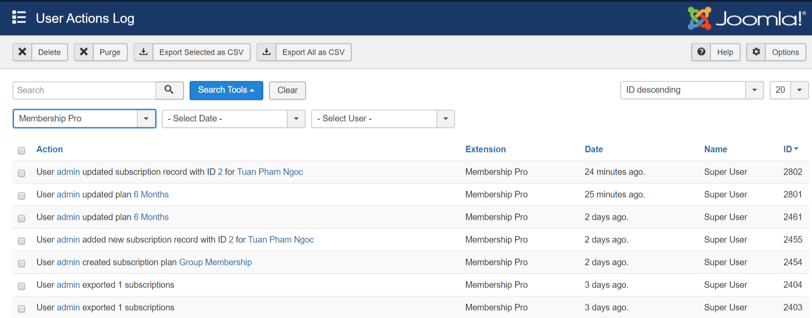

**Action Log - Membership Pro** records who performs actions in Membership Pro. The plugin can log the following actions.
- Add/Edit subscription plan.
- Publish/Unpublish subscription plans.
- Delete subscription plans.
- Add/Edit subscription
- Publish/Unpublish subscriptions.
- Delete subscriptions
- Export subscriptions

Go to **Extensions -> Plugins** and publish **Action Log - Membership Pro** to record the actions listed above. View the log under Users -> User Actions Log.

