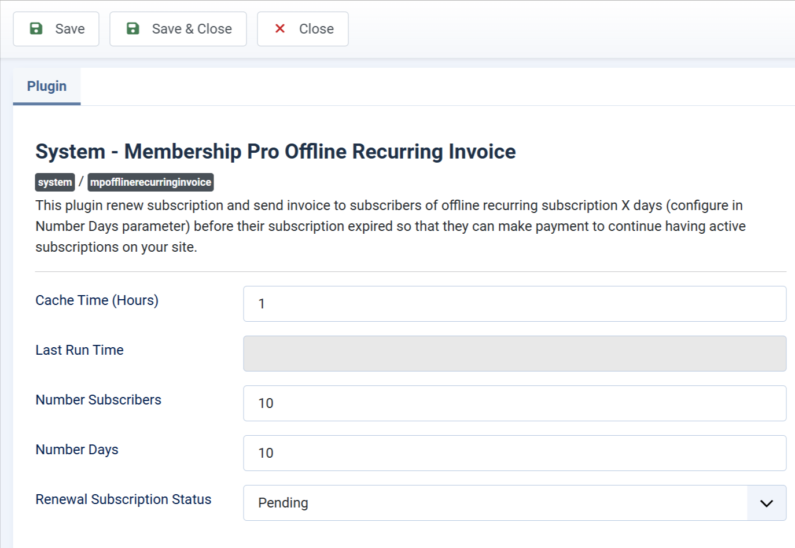

>>> This plugin was removed from version 4.2.1. Please use **[Membership Pro - Offline Recurring Invoice](/scheduled-tasks/incomplete-payment-subscriptions-notification)** scheduled task instead.

## When you need to use this plugin
This plugin can be used if you:
- Have recurring subscription plans on your site
- You allow subscribers to use offline payment method to subscribe for these recurring subscription plans

## How does it work
When this plugin is enabled, it will be run every 6 hours. Each time the plugin runs, it will find offline subscription records which will be expired in the next 10 days (Number of days can be configured in plugin parameter) and:
- Create a renewal subscription record with Pending subscription status
- Send an invoice (Pending status) to subscriber so that they know about this renewal and makes payment for the renewal manually (via bank transfer for example)
- After receiving payment for that renewal, administrator will approve/publish the renewal record to extend the active subscription for the subscriber.

## Enable and configure the plugin

1. Go to **System -> Plugins**, find and enable **System - Membership Pro Offline Recurring Invoice** plugin. Configure it's parameters (Cache Time, Number Subscribers, Number Days, Renewal Subscription Status...) if needed. However, default values for these parameters should be good enough
2. Go to **Membership Pro** -> **Emails & Messages**, look at **Recurring Subscription Messages** tab, find and setup the following email messages (which will be used to send emails to subscriber when the renewal happens containing the invoice):

- Offline Recurring Email Subject
- Offline Recurring Email Body

