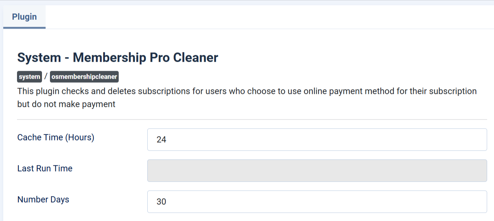

>>> This plugin was removed starting with version 4.2.1. Please use **[Membership Pro - Delete Incomplete Payment Subscriptions](/scheduled-tasks/delete-incomplete-payment-subscriptions)** scheduled task instead.

When users sign up for your subscription plans, they might ignore the payment for some reason (for example, close the browser without making payment after being redirected to PayPal...). In these cases, the subscription records will still remain in the system with **Pending** status.

If you want to clean up (mean delete) these records like that (it won't affect the function of the system), you can use **System - Membership Pro Cleaner** plugin. Go to **System** => **Plugins**, find and enable the plugin to use this feature.

