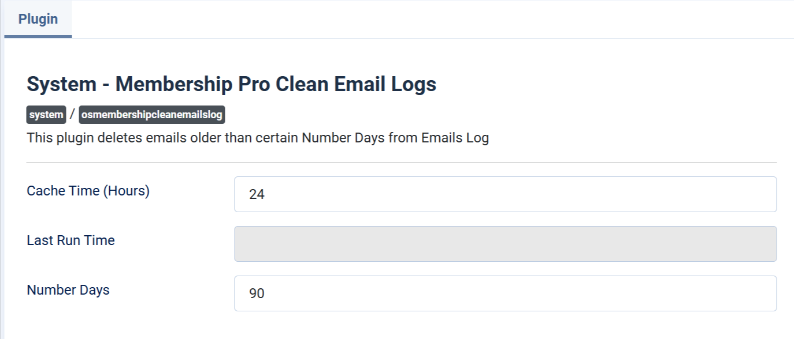

>>> This plugin was removed starting with version 4.2.1. Please use **[Membership Pro - Clean Emails Log](/scheduled-tasks/clean-emails-log)** scheduled task instead.

This plugin deletes emails older than certain Number Days (by default 90 days) from Emails Log. It is useful if you enable Log Emails option in Membership Pro.

Go to **System** -> **Plugins**, find and enable **System - Membership Pro Clean Email Logs** plugin and emails from emails log will be deleted automatically by the system if these emails are older than the configured Number Days

You might want to change **Number Days** parameter if you want to keep the emails shorter/longer than the default **90 days**.

