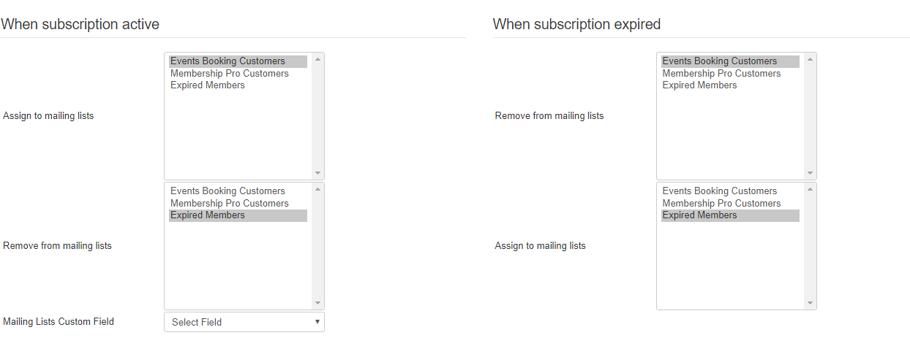
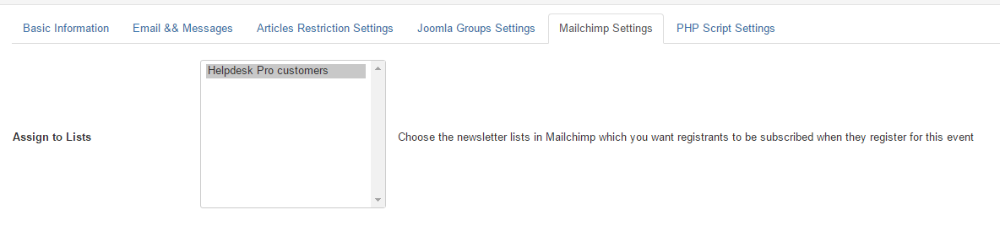
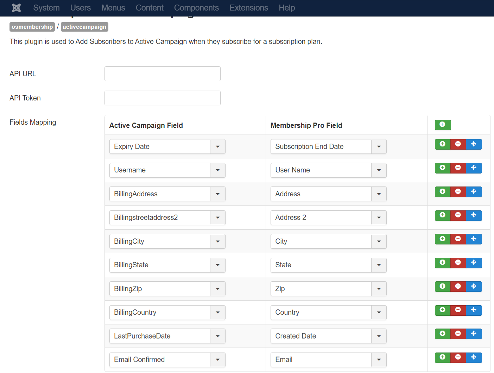
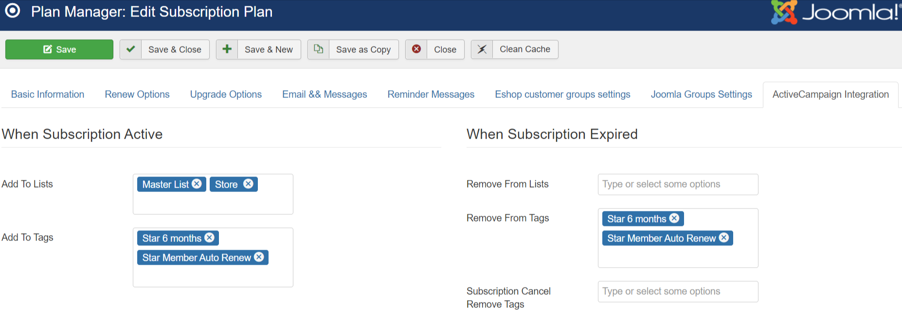

Membership Pro provides plugins that add subscribers to mailing lists so you can send them newsletters.

At the moment, Membership Pro supports [**ACYMailing**](https://www.acyba.com/) (a popular Joomla newsletter extension) and [Mailchimp](http://mailchimp.com/) (a popular email online marketting service)

## ACYMailing integration
This feature only works if you are using **ACYMailing** extension on your site. If you don't use **ACYMailing** extension, please ignore this section

1. Go to Extensions -> Plugins Manager, find and publish the plugin **Membership Pro - Acymailing plugin**
2. Now, when you add/edit a subscription plan, you will see a new tab called **Acymailing Settings**. On this tab, there are two sections:

### When subscription active
* **Assign To Mailing Lists**: Choose the mailing lists you want subscribers will be assigned to when they sign up for this subscription plan.
* **Remove From Mailing Lists**: Choose the mailing lists you want subscribers will be removed from when they sign up for this subscription plan. Usually, you don't need to choose any mailing lists here unless in **When subscription expired** section, you choose to assign expired subscribers to certain mailing list (like **Expired Members**) and if you do so, you should choose to remove them from that **Expired Members** mailing list when they sign up for this plan.

### When subscription expired

* **Remove From Mailing Lists**: Choose the mailing lists which you want subscribers of this plan will be removed from when their subscription for this plan is expired. Usually, it should be the same with the mailing lists you selected in **Assign to mailing lists** setting under **When subscription active** section.
* **Assign to mailing lists**: Choose the mailing lists you want subscribers will be assigned to their subscription for this plan is expired. Usually, you don't need to choose any mailing lists here unless you want to assign expired subscribers to **Expired Members** mailing list for your records (for example, send them newsletter email to ask them to renew their subscription...)

### Allow subscribers to choose the mailing lists
If you want to allow your subscribers to choose the mailing lists they want to subscribe to (instead of assigned them automatically to the pre-selected mailing lists like in the setup above), you can follow the instructions below:
1. Go to Membership Pro -> Custom Fields, create a Checkboxes custom field to allow users to choose the mailing lists they want to subscribe to. Each option in this Checkboxes custom field must have exact same value with List Name you created in ACYMailing.
2. Edit the plan, look at **Acymailing Settings** tab, choose the custom field which you created above for **Mailing Lists Custom Field** setting.
3. Now, when users sign up for this plan, they can choose the mailing lists they want to subscribe to and the system will only assigned them to the mailing lists which they selected.

## Mailchim Integration

1. Go to Extensions -> Plugins Manager, find and publish the plugin **Membership Pro - Mailchimp** plugin.
2. Get the **API Key** of your Mailchimp account (you can see instructions at [http://kb.mailchimp.com/accounts/management/about-api-keys](http://kb.mailchimp.com/accounts/management/about-api-keys), **enter it into API key of the plugin parameter**.
3. Now, when you add/edit a subscription plan, you will see a new tab called **Mailchimp Settings**. Choose the Mailing Lists you want subscribers of this plan will be assigned to in **Assign to Lists** parameter

After that, when users sign up for this subscription plan, they will be assigned to the selected mailing lists and you can use **Mailchimp** to send newsletter to them in the future.

## Active Campaign
1. Go to Extensions -> Plugins Manager, find and enable the plugin **Membership Pro - ActiveCampaign**
2. Click on the plugin to edit:
- Get **URL**, **Key** from your ActiveCampaign account (in Settings -> Developer section), enter into API URL and API Key parameters of the plugin.
- In the **Fields Mapping**, map the fields which you want to pass from Membership Pro to ActiveCampaign if needed (first_name, last_name, phone, email are passed by default, so you don't need to map these fields)
4. Now, when you add/edit a subscription plan, you will see a new tab called **ActiveCampaign Integration**. Here you can choose the **lists**, **tags**  which subscribers will be added to when their subscription active and will be removed from when their subscription expires.

