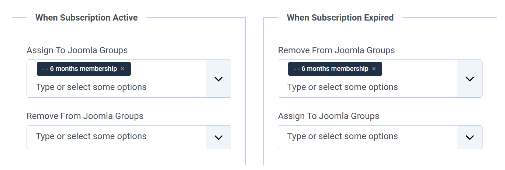

You can assign subscribers to selected **Joomla user group(s)** when they sign up for a plan in **Membership Pro**. Joomla's access control then lets you grant those groups permissions or access to resources reserved for subscribers. Follow these steps to enable the integration.
1. Log in to the backend of your site with a super administrator account.
2. Go to Users -> Groups and create a Joomla user group, for example **Subscriber**. Make it a child of **Registered**.
3. Go to **System -> Plugins** and enable **Membership Pro - Joomla Groups plugin**.

When you create or edit a plan, open the **Joomla Groups Settings** tab. It has two sections.

### When subscription active
* **Assign to Joomla Groups**: Choose the groups to add subscribers to when they sign up for this plan. For example, select the **Subscriber** group you just created.
* **Remove from Joomla Groups**: Choose the groups to remove subscribers from when they sign up for this plan. You can usually leave this field blank. If you assign expired subscribers to a group such as **Expired Members** under **When subscription expired**, select **Expired Members** here so they are removed when they sign up again.

### When subscription expired

* **Remove from Joomla Groups**: Choose the groups to remove subscribers from when this subscription expires. Usually, use the same groups you selected in **Assign to Joomla Groups** under **When subscription active**, such as **Subscriber**.
* **Assign to Joomla Groups**: Choose the groups to add subscribers to when this subscription expires. You can usually leave this field blank. To track expired subscribers in a group, select a group such as **Expired Members**.

With this setup, users join the **Subscriber** group when they sign up and can access its resources. When the subscription expires, they leave the **Subscriber** group and lose access until they renew.

Use this plugin to restrict resources through Joomla's access control. You need to know how to configure Joomla ACL.

