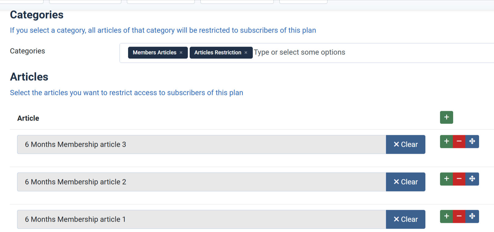
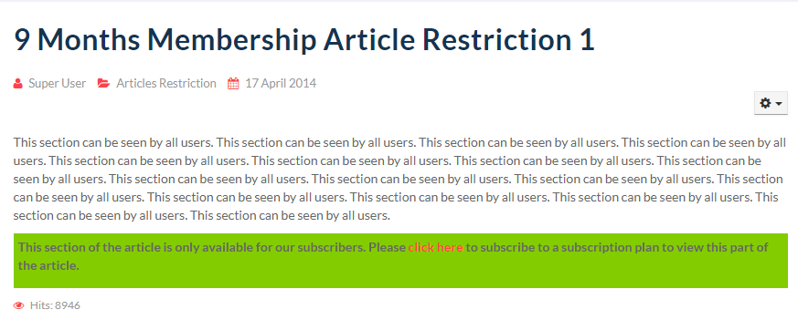

## Introduction
This method can be used if you want to have a page which display a list of articles (for example this page [https://demo.joomdonation.com/membershippro/articles-restriction](https://demo.joomdonation.com/membershippro), only intro text of the articles are showed). When users click on the link to read the full article:

1. If he has an active subscription of the plan which is allowed to access the article, they will be allowed to access article detail page to read the full article
2. If he doesn't have an active subscription of the plan which is allowed to access the article, he will be redirected to the plans list page with a message ask him to sign up for the needed plans if he want to access the article. You can access to this link https://demo.joomdonation.com/membershippro/pages-restriction/page-1 to understand how it works

## Setup and Configure
1. Go to Extensions -> Plugins Manager, find and publish the plugin **System - Membership Pro Articles Restriction**. 
2. Now, when you add/edit a subscription plan, you will see a new tab called **Articles Restriction Settings** displays categories and articles that you set up on your site.
3. In the **Categories** section, you can select the categories you want and all articles from these selected categories will be restricted to subscribers of this plan.
4. In the **Articles** section, you can select the individual articles you want and these restricted articles will be restricted to subscribers of this plan.

## Plugin Parameters
* **Redirect URL**: Enter URL of the page which you want to redirect none-subscribers to when try to access your restricted article. This should be  URL of the page which display a list of subscription plans so that users can sign up to access your articles. Leave it empty and the system will detect the URL automatically
* **Protection Method**: This parameter control the behavior when one subscribers try to access to a restricted article. If you set it to **Prevent Access to Article Detail Page**, users will be redirected to the **Redirect URL** page which you configured above. If you set it to **Hide fulltext from none subscribers**, the system will display a message (configurable) telling them that they need to subscribe to your plans to access that section of the article. See demo at [https://demo.joomdonation.com/membershippro/articles-restriction/9-months-membership-article-restriction](/articles-restriction/9-months-membership-article-restriction)
* **Display Articles in Profile**: If you set it to Yes, when subscribers access to his user profile [https://docs.joomdonation.com/membershippro/frontend-items/user-profile](/frontend-items/user-profile) , he will see a tab called **My Articles** which display a list of available articles for his subscription so that they can access to these articles.

## Change the restriction message
If you set **Protection Method** parameter to Hide fulltext from none subscribers, there would be a message displayed to replace the fulltext. If you want to change that message, go to **Membership Pro -> Emails & Messages**, look at **General Messages** tab, find and change **Content Restricted Message**.

## Display plans in restriction message

If you want to display the plans which users can subscribe to access restricted article, you can follow instructions below to set it up:

- Go to Extesnions -> Plugins, enable **Content - Membership Plans** plugin. Choose the layout you want to use to display plans in the plugin parameter.
- Change the **Content Restricted Message** above, add the {membershipplans ids="[PLAN_IDS]"} syntax to the position you want to display the plan.