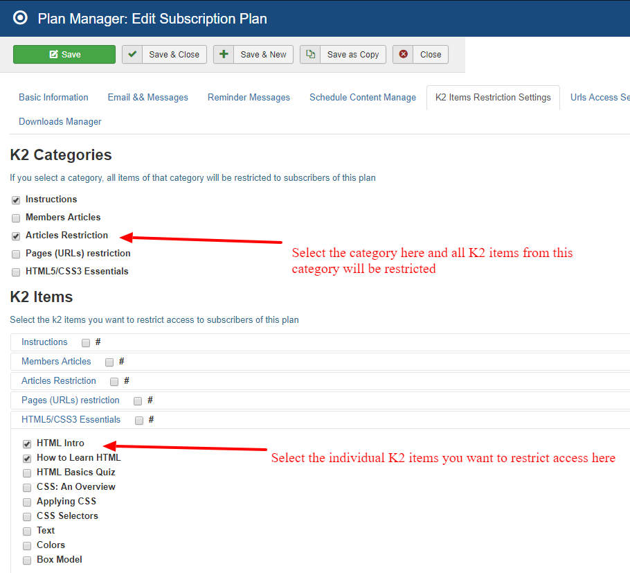
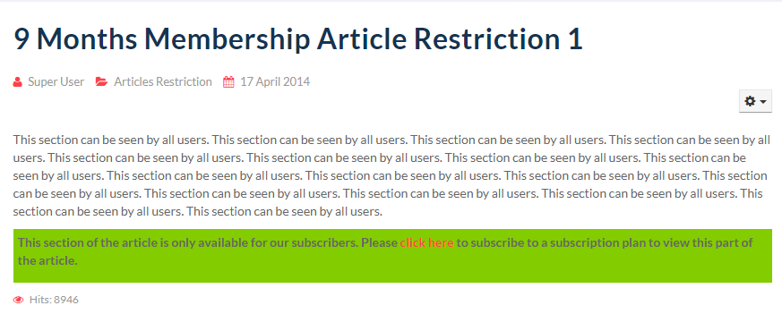

## Introduction
This method can be used if you want to have a page which display list of k2 items (for example this page https://demo.joomdonation.com/membershippro/articles-restriction, only intro text of the articles are showed). When users click on the link to read the full article:

1. If he has an active subscription of the plan which is allowed to access to the article, they will be allowed to access to k2 item detail page to read the full item.
2. If he doesn't have an active subscription of the plan which is allowed to access to the K2 item, he will be redirected to the plans list page with a message ask him to sign up for the needed plans if he want to access to the item.

## Setup and Configure
1. Go to Extensions -> Plugins Manager, find and publish the plugin **System - Membership Pro K2 items Restriction**. 
2. Now, when you add/edit a subscription plan, you will see a new tab called **K2 Items Restriction Settings** displays K2 categories and items which you setup on your site.
3. In the **K2 Categories** section, you can select the categories you want and all K2 items from these selected categories will be restricted to subscribers of this plan.
4. In the **K2 Items** section, you can select the individual K2 items you want and these restricted K2 items will be restricted to subscribers of this plan.

## Plugin Paramerers
* **Redirect URL**: Enter URL of the page which you want to redirect none-subscribers to when try to access to your restricted article. This should be  URL of the page which display list of subscription plans so that users can sign up to access to your articles. Leave it empty and the system will detect the URL automatically
* **Protection Method**: This parameter control the behavior when one subscribers try to access to a restricted article. If you set it to **Prevent Access to Article Detail Page**, users will be redirected to the **Redirect URL** page which you configured above. If you set it to **Hide fulltext from none subscribers**, the system will display a message (configurable) telling them that they need to subscribe to your plans to access to that section of the article. See demo at [https://demo.joomdonation.com/membershippro/articles-restriction/9-months-membership-article-restriction](https://demo.joomdonation.com/membershippro/articles-restriction/9-months-membership-article-restriction)
* **Display K2 items in Profile**: If you set it to Yes, when subscribers access to his user profile [https://docs.joomdonation.com/membershippro/frontend-items/user-profile](/frontend-items/user-profile) , he will see a tab called **My K2 items** which display list of available K2 items for his subscription so that they can access to these articles.

## Change the restriction message
If you set **Protection Method** parameter to Hide fulltext from none subscribers, there would be a message displaayed to replace the fulltext. If you want to change that message, go to **Membership Pro -> Emails & Messages**, look at **General Messages** tab, find and change **Content Restricted Message**.

## Display plans in restriction message

If you want to display the plans which users can subscribe to access to restricted article, you can follow instructions below to setup it:

- Go to Extesnions -> Plugins, enable **Content - Membership Plans** plugin. Choose the layout you want to use to display plans in the plugin parameter.
- Change the **Content Restricted Message** above, add the {membershipplans ids="[PLAN_IDS]"} syntax to the position you want to display the plan.