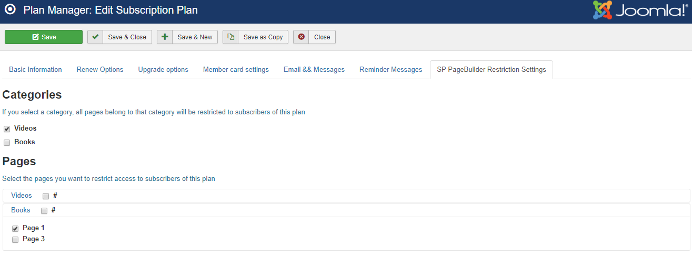
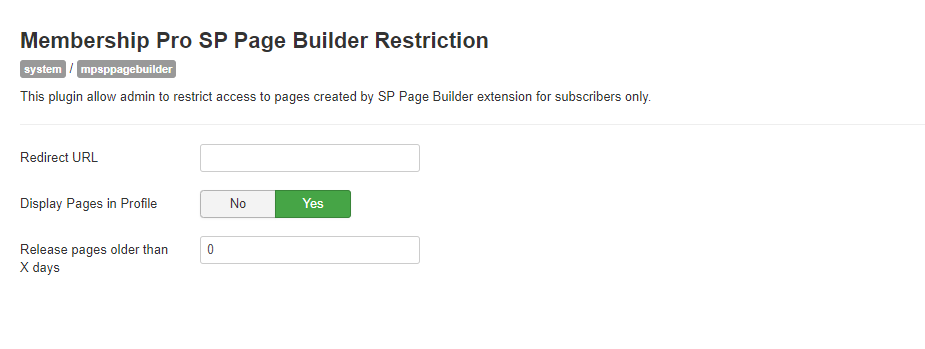

## Introduction
This method can be used if you want to restrict access to pages created by [SP PageBuilder](https://www.joomshaper.com/page-builder) extension. When someone tries to access a restricted page and doesn't have an active subscription of the required subscription plan, he will be redirected to the plans list page with a message ask him to sign up for the needed plans.

## Setup and Configure
1. Go to Extensions -> Plugins Manager, find and publish the plugin **System - Membership Schedule SPPageBuilder**. 
2. Now, when you add/edit a subscription plan, you will see a new tab called **SP PageBuilder Restriction Settings** displays SP Page Builder categories and pages which you created.
3. In the **Categories** section, you can select the categories you want and all pages belong to these selected categories will be accessible by subscribers of this plan.
4. In the **Pages** section, you can select the individual pages you want and these pages will be accessible by subscribers of this plan.

## Plugin Paramerers
* **Redirect URL**: Enter URL of the page which you want to redirect none-subscribers to when try to access your restricted article. This should be  URL of the page which display a list of subscription plans so that users can sign up to access your articles. Leave it empty and the system will detect the URL automatically
* **Display Pages in Profile**: If you set it to Yes, when subscribers access to his user profile [https://docs.joomdonation.com/membershippro/frontend-items/user-profile](/frontend-items/user-profile) , he will see a tab called **My pages** which display a list of available pages for his subscription. He can then click on the page he wants to see the details page
* **Release pages older than X days**: If you enter a number here, the pages will be released and accessible after that number of days since it's created date.

