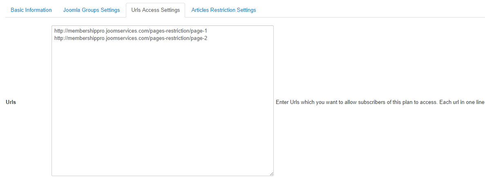

If you have a generic resources (which you know urls) and cannot be restricted by the three mentioned methods (for example, link to a page has video displayed, link to a list of members in Jomsocial, link to access forum....), you can use the **Membership Pro URLs Restriction** plugin to restrict access to these urls. With this method, any pages on your site (which is generated by Joomla - not a static links such as link to a video file on your server) can be restricted to subscribers. This can be used in case:

1. You want to create menu items to link to these resouces. Users will see these menu items. However, when they click on the menu item to access the resources, if they don't have an active subscription, they will be be redirected to Plans list page which ask them to subscribe before they can access to the page/menu item. See Page Restriction sub menu items on our demo sitte http://membershippro.joomservices.com/ to understand how it works.
2. Maybe you will have a page which display a list of resources and each resource has a link to access it (for example, a category page which display a list of videos...). When users click on the link to view detail of the resouce (the video detail page for example), if they don't have an active subscription, they will be be redirected to Plans list page which ask them to subscribe before they can access to the resource

To use this method, please follow the steps below:

1. Go to **Extensions -> Plugins Manager**, find and publish the plugin **Membership Pro URLs Restriction**. In the plugin, there is a parameter called **Display Urls in Profile**. If you want your subscribers to see all the urls that you set up here in his membership profile under **My Pages** tab, set this parameter to **Yes**.
2. Now, edit the plan, you will see a new tab called **URLs Access settings**
3. Enter the urls you want to restrict access to subscribers of that plan into the textarea in the URLs Access settings tab. Please note:
* Each url must be entered on one line
* Please **DON'T ENTER www** in these urls

