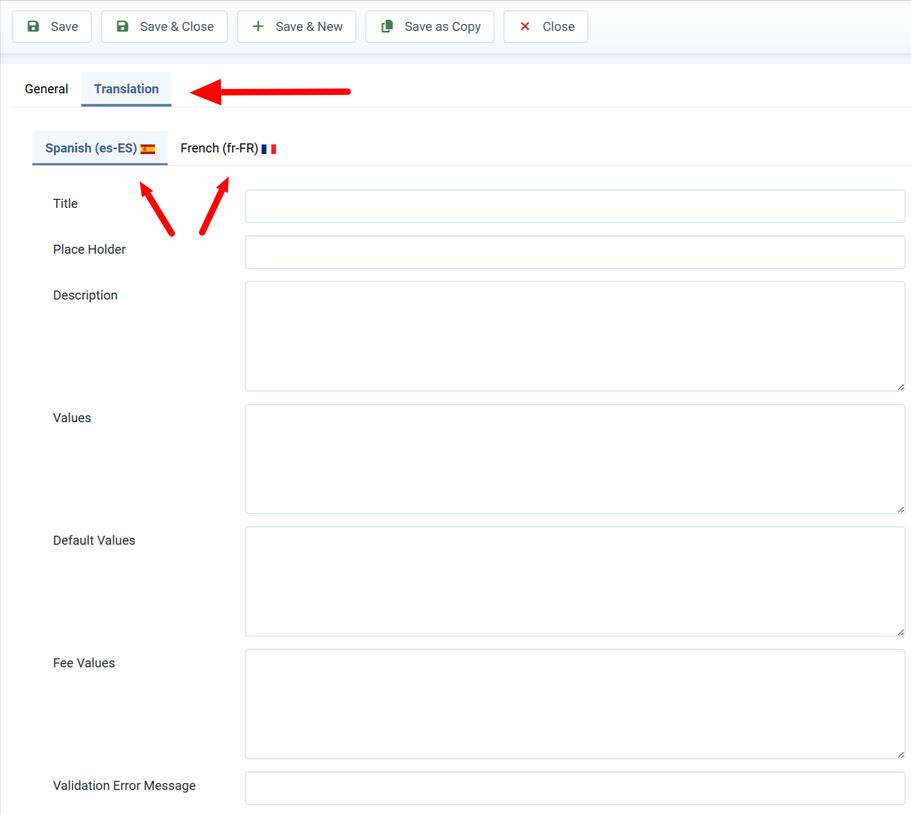

**Membership Pro** supports multilingual sites. In Joomla core, you create a separate record for each language, for example when translating an article.

In Membership Pro, create one record and add its translations in the Translation tab when editing the record.

The sections below explain where to translate each part of Membership Pro for a multilingual site.

## Translate language items

Go to **Membership Pro -> Translation** and translate the extension's language items for each language on your site.

## Translate categories

If you use categories, open the Categories Management screen and select a category to edit. On the **Translation** tab, translate the category into each language apart from the default language.

## Translate plans

On the Subscription Plans Management screen, select a plan to edit. On the **Translation** tab, translate the plan into each language apart from the default language.

## Translate custom fields

On Custom Fields Management screen, click on a plan to edit. Look at **Translation** tab, translate the custom field to all other languages (beside default language) used on your site.

## Translate Emails & Messages
To translate **Emails & Messages**, go to **Membership Pro -> Emails & Messages** and open each message. On the **Translation** tab, translate the message into each language apart from the default language.

>>>>>> On a multilingual site, an SQL error can occur if the database tables are missing fields required for translations. If this happens, run **Tools => Fix Database Schema**.