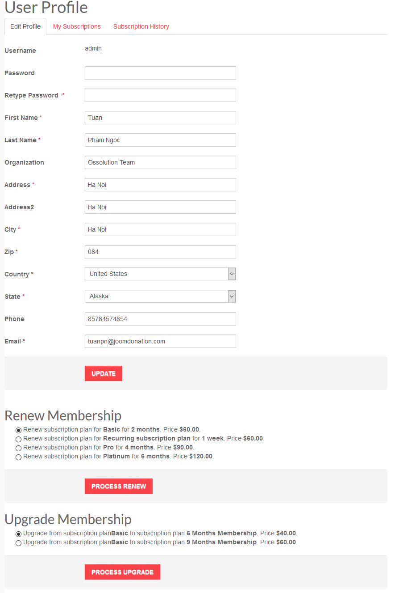
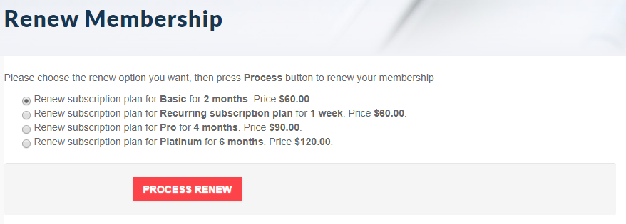
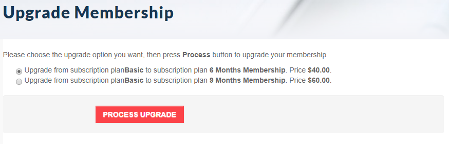
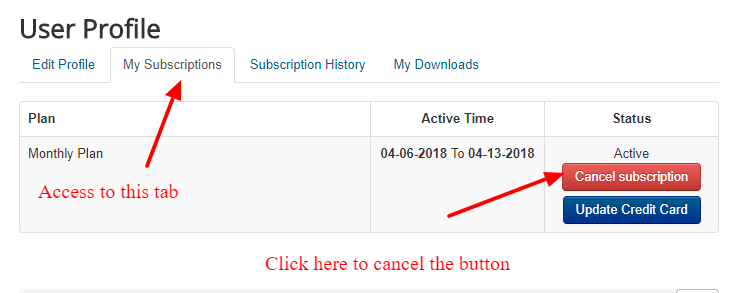

In this article, we will see how to subscribers can perform neccesary actions releated to their membership on your site.

## Update profile data
After users subscribe for your subscription plans, you should provide a way for them to update their profile data if they want. To do that, setup and use this [**User Profile**](/frontend-items/user-profile) menu option. Subscribers can then access to that menu option to update his profile data whenever they want. 

## Renew Membership
Usually, when users subscribe for your subscription plans, their subscription will be expired after certain time (for example, one month, one year...). You must give subscribers a way to renew their subscription, to do that, create at least one of menu items below:

- Create a menu item to link to [**User Profile**](/frontend-items/user-profile) menu option
- Create a menu item to link to [**Renew Membership**](/frontend-items/renew-membership) menu option

Subscribers can then access to this menu item, see available renew options for their membership, choose the option they want and process the renewal.

## Upgrade Membership
In your system, you might want to setup upgrade rules to allow users from upgrading to a subscription plan to a higher level subscription plan (with access to more restricted resources or with higher subscription duration). To do that, create at least one of menu items below:

- Create a menu item to link to [**User Profile**](/frontend-items/user-profile) menu option
- Create a menu item to link to [**Upgrade Membership**](/frontend-items/upgrade-membership) menu option

Subscribers can then access to this menu item, see available upgrade options for their membership, choose the option they want and process upgrade membership.

## Cancel Recurring Subscription
If you setup recurring subscription plans on your site, users might be able to cancel the recurring subscriptions which they subscribed. However, not all payment gateways support this API, so users can only cancel recurring subscription from within your site if they subscribed using one of the following payment plugins:

- PayPal (You need to use a business PayPal account and configure Advanced Parameters, see [https://docs.joomdonation.com/membershippro/basic-setup/payment-plugins/paypal#advanced-settings](/basic-setup/payment-plugins/paypal#advanced-settings) )
- PayPal Pro
- Authorize.net
- Stripe
- Stripe Checkout
- Mollie

To allow subscribers to cancel recurring subscriptions, you can create a menu item to link to [**User Profile**](/frontend-items/user-profile) menu option. Users can access to this menu item, access to My Subscriptions tab, click on **Cancel Subscription** button to cancel the subscription

For other payment plugins you can contact administrator, ask them to cancel the recurring subscriptions for you (they will need to login to their payment gateway account, find the recurring subscription and cancel it)

## Update credit card
This feature allow subscribers (who uses credit card base payment method to sign up for a recurring subscription plan) to update their credit card information (for example, when their original credit card is expired) so that payment gateway can continue process recurring subscription. Currently, only Stripe payment plugin support it. If you use Stripe, you can setup the system to enable this option:

- Create a menu item to link to [**User Profile**](/frontend-items/user-profile) menu option. Subscribers can access to this menu item, access to **My Subscriptions** tab, click on **Update Credit Card** button to update the credit card information use for the recurring subscription

