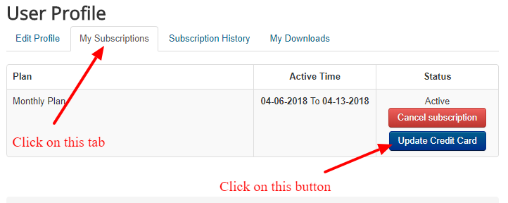

Subscribers can manage their membership from the frontend of your site. The following sections explain the actions available to them.

## Update profile data
Create a menu item using the [**User Profile**](/frontend-items/user-profile) menu option so subscribers can update their profile after signing up.

## Renew Membership
Subscriptions often expire after a specified period, such as one month or one year. To let subscribers renew, create at least one of these menu items.

- Create a menu item to link to [**User Profile**](/frontend-items/user-profile) menu option
- Create a menu item to link to [**Renew Membership**](/frontend-items/renew-membership) menu option

Subscribers can open the menu item, choose an available renewal option, and complete the renewal.

## Upgrade Membership
You can set up upgrade rules to let subscribers move to a plan with access to more restricted resources or a longer subscription period. Create at least one of these menu items.

- Create a menu item to link to [**User Profile**](/frontend-items/user-profile) menu option
- Create a menu item to link to [**Upgrade Membership**](/frontend-items/upgrade-membership) menu option

Subscribers can open the menu item, choose an available upgrade option, and complete the upgrade.

## Cancel Recurring Subscription
Subscribers can cancel a recurring subscription from your site if they used one of the following payment plugins.

- PayPal (You need to use a business PayPal account and configure Advanced Parameters, see [https://docs.joomdonation.com/membershippro/basic-setup/payment-plugins/paypal#advanced-settings](/basic-setup/payment-plugins/paypal#advanced-settings) )
- PayPal Pro
- Authorize.net
- Stripe
- Stripe Checkout
- Mollie

Create a menu item using the [**User Profile**](/frontend-items/user-profile) menu option. Subscribers can open the My Subscriptions tab and click **Cancel Subscription**.

For other payment plugins, subscribers can ask a site administrator to cancel the recurring subscription. The administrator must log in to the payment gateway, find the subscription, and cancel it there.

## Update credit card
Subscribers who pay for a recurring plan by credit card can update their card details, for example when their card expires, so the gateway can keep processing payments. Currently, only the Stripe payment plugin supports this feature.

- Create a menu item using the [**User Profile**](/frontend-items/user-profile) menu option. Subscribers can open the **My Subscriptions** tab and click **Update Credit Card** to change the card used for recurring payments.

