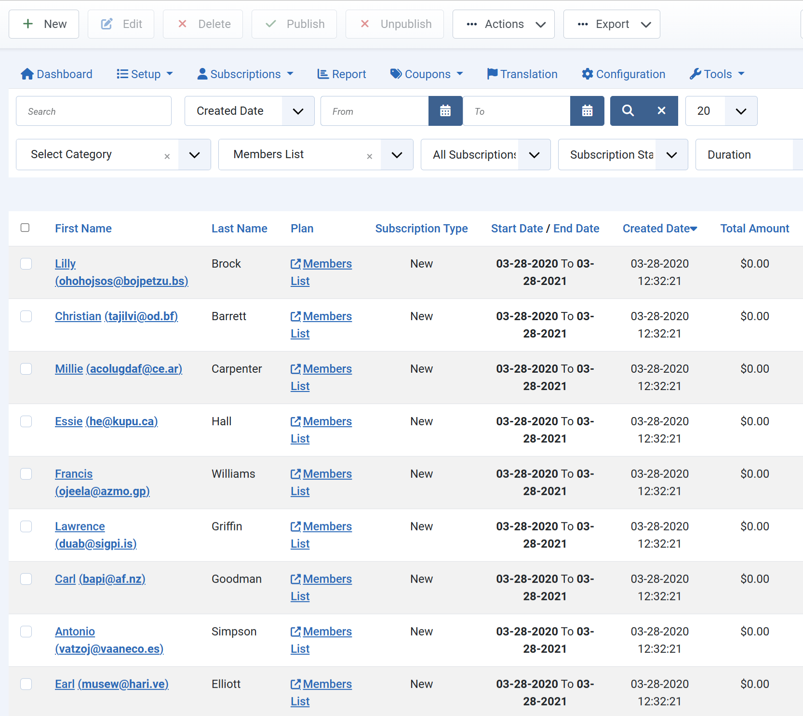

You can open the subscriptions management page in three ways.

1. Access to **Components -> Membership Pro -> Subscriptions**
2. Access to Membership Pro Dashboard, then click on **Subscriptions** icon
3. On any pages in Membership Pro, access to **Subscriptions -> Subscriptions**

From this page, you can see a list of subscription records, filter subscription records by plans, by subscription status, by subscription type (new subscription, Subscription Renewal, Subscription Upgrade)

