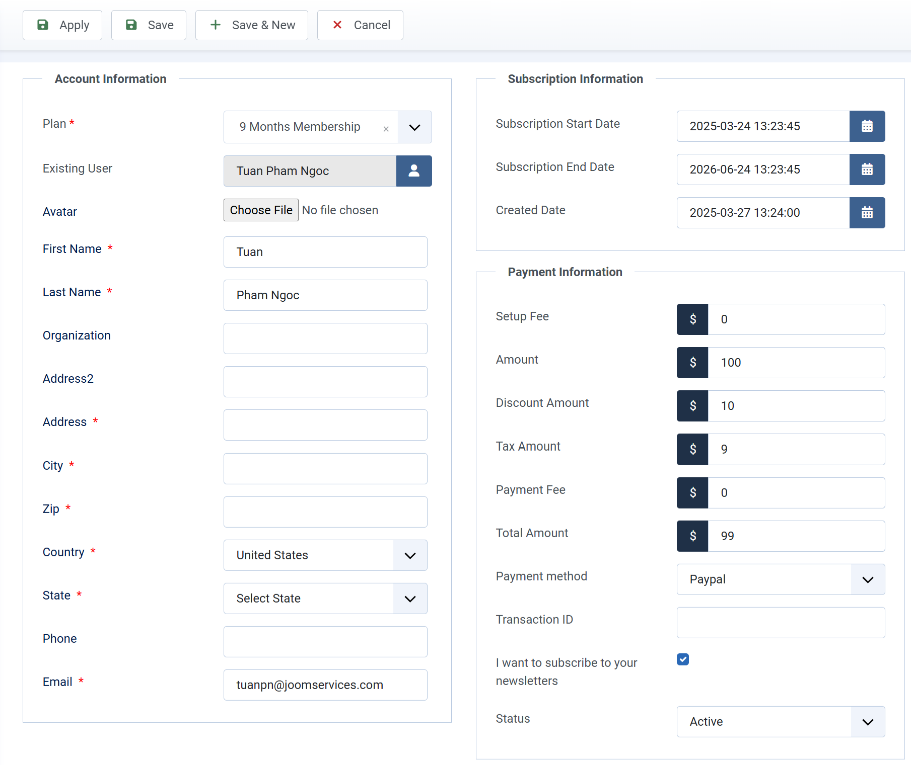

Sometime, you will need to add subscription record manually (for example, when users make phone call ask you to subscribe them into your membership system ..). To do that, from subscriptions management screen, select the plan you want to add subscription from plans filter dropdown, press **New** button in the toolbar to add new subscription record. A form will be displayed to allow you enter information for the subscription

1. When add new subscription record, you can choose an existing user or enter username and password to create a new user for the record. If you choose an existing user, the system will try to fill-in the form fields auto-manatically from the data stored in his profile.
2. You can leave the amount inputs (Total Amount, Discount Amount, Tax Amount, Amount) empty and the system will calculate it automatically.

After entering all necessary data, please press Save button in the toolbar to save the subscription