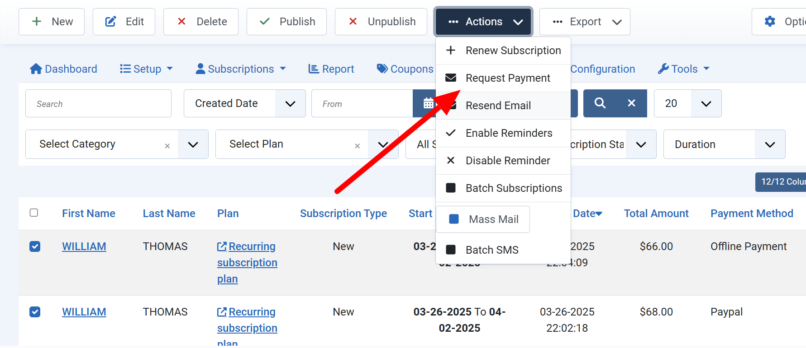

Sometimes, you would want to send and email to your subscribers (who has not processed payment for the subscription yet) to ask them to make a payment for registration. This usually happens when:

- Registrants choose Offline payment method for the subscription, but now, they want to use online payment methods (such as PayPal, Stripe...) to make a payment instead of sending payment manually to you.
- Or someone sign up for the plan, but the payment was failed for some reason. Instead of asking them to re-sign up for the plan, you can just send request payment email to them so that they can click on the link in the email to complete payment for the subscription

If you need to use this feature:

- From Subscriptions Management screen, check on the checkbox next to the subscription record which you want to send request payment email
- And click the **Request Payment** button in the toolbar.

When you do that, the subscriber will receive an email contains link to process payment for that subscription. They can click on the link, enter necessary information to process payment for subscription to have active subscription.

You should go to **Membership Pro -> Emails & Messages**, find and change the subject and body of the email will be sent when you use this **Request Payment** feature:

- **Request Payment Email Subject**
- **Request Payment Email Body**

