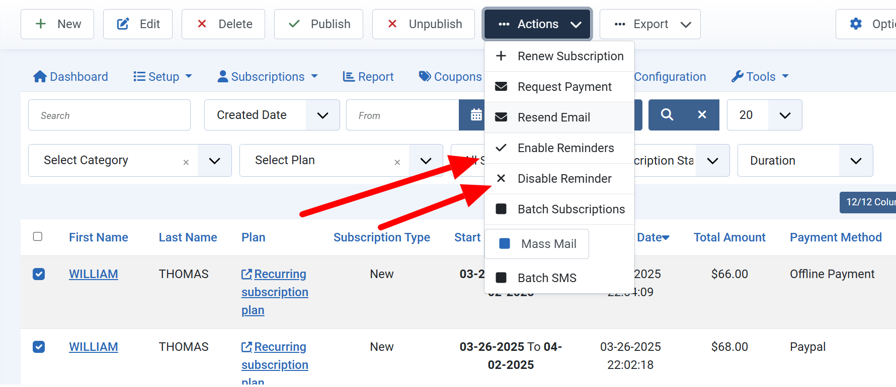

Sometime, you might want to Enable (in case the reminders were sent before but subscribers did not receive) or Disable (in case you do not want to send reminders or whatever reasons) sending reminder emails or certain subscription records. To do that:

1. Access to Subscriptions Management screen.
2. Check on the checkbox next to the subscriptions you want to Enable/ Disable reminder
3. Press **Actions -> Enable Reminders** or **Actions -> Disable Reminders**  button in the toolbar to enable/disable sending reminders for the selected subscriptions

- When you enable reminders, the system will still reminder emails for those subscriptions next time the sending reminder process triggered even if reminders were sent to these subscriptions before
- When you disable reminders, the system won't send reminders to these subscriptions anymore.

