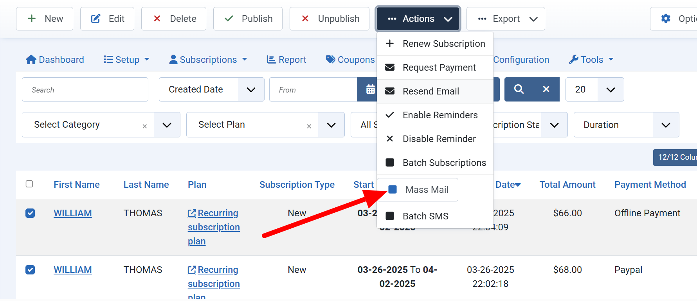

Membership Pro allows you to compose email and send it to the selected subscribers you want. To do that, from Subscriptions Management screen:

1. Check on the checkbox next to subscription records you want to send email.
2. Click on Mass Mail button in the toolbar. A popup window will be displayed to allow you to compose email
3. Enter Email subject, email message, choose the attachment (if needed)
4. You can use the following tags in the email message: **[PLAN_TITLE]**, **[FROM_DATE]**, **[TO_DATE]**, **[CREATED_DATE]**, , **[FIRST_NAME]**, **[LAST_NAME]**, **[ORGANIZATION]**..... (you can use any core fields - id smaller than 14) with the syntax [NAME_OF_FIELD_IN_UPPERCASE].
5. Press Process button at the bottom to send email

