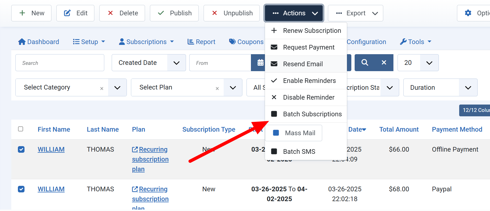
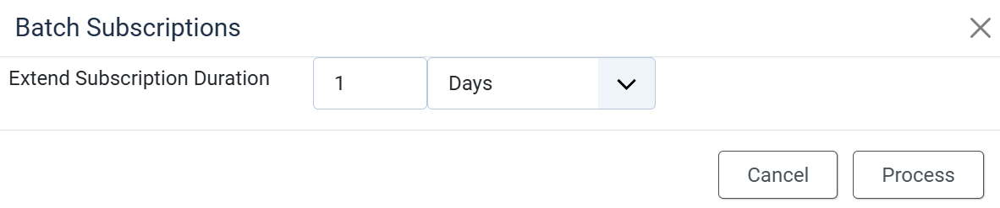

**Batch Subscriptions** allows you to make changes to multiple subscription records at once. Currently, the only supported action is extend subscription records for certain duration (for example, 10 days, 2 weeks, 1 months....). To use this feature:

1. Access to Subscriptions Management screen.
2. Check on the checkbox next to the subscriptions you want to make changes
3. Click the **Actions -> Batch Subscriptions** button in the toolbar. A popup screen will be displayed to allow you to perform the actions you want with the selected subscriptions.

### Extend Subscription Duration

To extend the subscription duration, choose the duration you want to extend in **Extend Subscription Duration** parameter, then click the **Process** button

