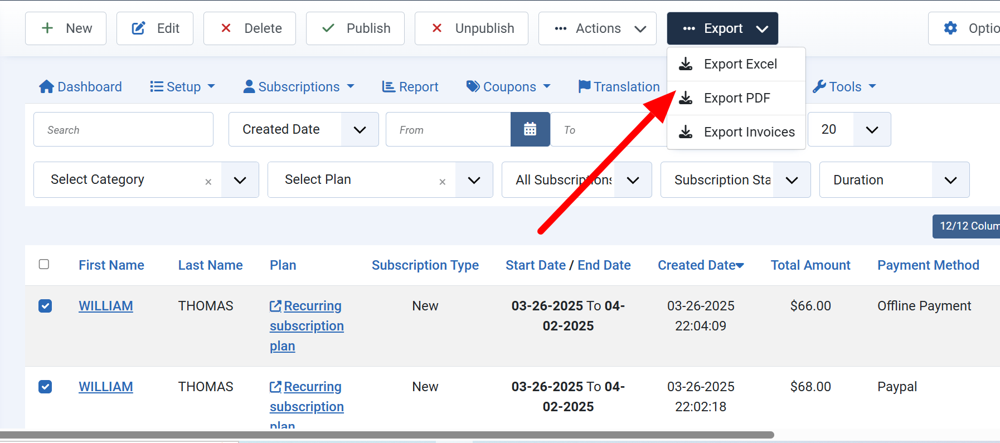

Membership Pro allows you to export subscriptions of one or all subscription plans to Excel/PDF. On Subscriptions Management screen, you can press one of the export buttons in **Export** button group in the toolbar to export subscriptions from one selected plan or from all plans. Note that, before pressing **Export Subscriptions** button, you can filter subscriptions data you want and only subscriptions meet the filters will be exported:

- If you only want to export subscriptions from one plan, select that plan from Plans filter dropdown
- If you only want to export subscriptions with certain Status (Pending/Active/Expired...), you can choose that status from Status filter dropdown
- If you only want to export subscriptions from certain type (New Subscriptions, Subscription Renewal, Subscription Upgrade), you can choose that subscription type from All Subscriptions dropdown.
- You can also choose date range, enter keyword in the search box to search for subscriptions you want before export

- Press **Export -> Export Excel** will export subscriptions into Excel (XLSX) format.
- Press **Export -> Export PDF** will export subscriptions into PDF format.
- Press **Export -> Export Invoices** will export PDF invoices of the subscriptions

