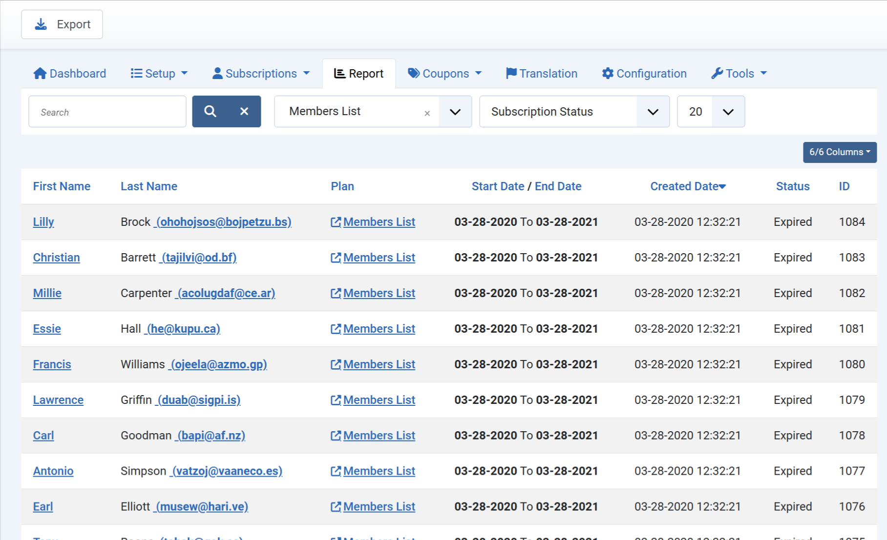

Membership Pro creates a new subscription record for each renewal. A subscriber can have several records for the same plan, which can make it harder to find their start and expiration dates.

Go to Membership Pro -> Report to see one record per user. It shows their current subscription status (Pending/Active/Expired), start date, and expiration date.

Click **Export** in the toolbar to export the report.

