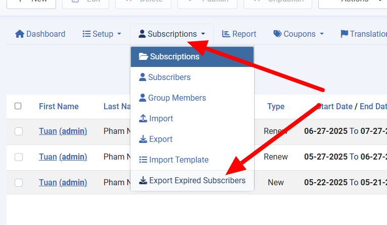

From any page in Membership Pro administrator area, you can access to **Subscriptions** -> **Export Expired Subscribers**. It will give you a list of expired subscriptions in the system (who has all of his subscription expired). Subscribers who has at least active subscription in his account won't be included in this list.

