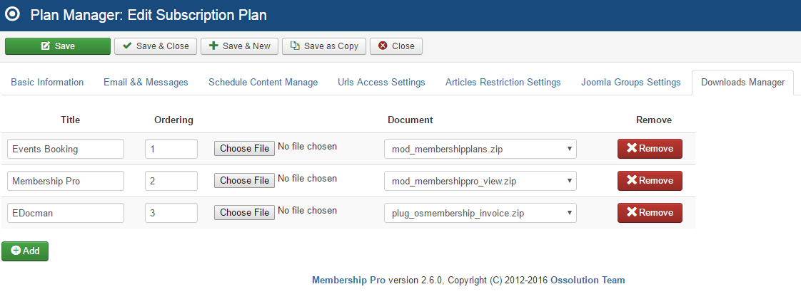
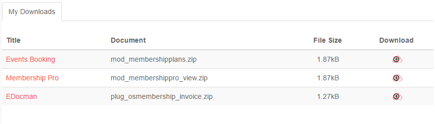
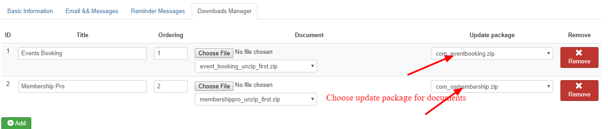

This plugin allows you to upload and give your active subscribers permission to download certain files/documents you want for each subscription plan.

To use this plugin, please follow the steps below:
1. Go to System -> Plugins, find and enable the plugin **Membership Pro - Documents plugin**
2. Go to Membership Pro -> Subscription Plans, click on a plan to edit, you will see a new tab called **Downloads Manager** which allows you to upload files/documents which will be available for subscribers of this plan. Select and upload the files you want 
3. After subscribers subscribe for the plan, he can go to user profile page, access to My Downloads tab to see and download the documents which you upload in the step #2 above 

## Implement Joomla! Update System
This feature is only used in case you are using Membership Pro to sell Joomla extensions and want to implement Joomla update mechanism to allow your customers to update to latest version of your extensions from within administrator area of your site. So if you don't use Membership Pro to sell Joomla extensions, please ignore this section of the document. Download this skeleton [joomla_update_skeleton.zip](joomla_update_skeleton.zip) and use it as a sample and reference would help you understand the documentation below easier

### Set update packages for your extensions
1. Create a folder called **update_packages** under the folder which you store your documents to store update packages (by default, it is **media/com_osmembership/documents**, so this folder will be **media/com_osmembership/documents/update_packages**)
2. Upload the update packages of your extensions o the new folder which you created above via FTP.
3. Go to Membership Pro -> Subscription plans, edit your plan and choose Update Package (which you uploaded) for each document


### Defining an update server
For more information about update server, please read Joomla official document [https://manual.joomla.org/docs/building-extensions/install-update/installation/manifest/#update-server](https://manual.joomla.org/docs/building-extensions/install-update/installation/manifest/#update-server). Basically, you will need to do two things:
1. Create an XML file contains update information of your extension. See a sample file here [updates.xml](updates.xml) . Below are some important notes:
* **element** tag: The installed name of the extension. I could find clear documentation about value of this tag. From my experience, if our extension package has name **osmembership**, then the name of xml manifest of the package should be pkg_osmembership.xml, **packagename** tag should be ```<packagename>osmembership</packagename>``` and the element tag must be ```<element>pkg_osmembership</element>```
* **downloadurl** tag must has this format https://www.domain.com/index.php?option=com_osmembership&amp;task=download_update_package&amp;document_id=58. https://www.domain.com must be replaced with the full url of your site, and **58** in the above url must be replaced with ID of the document (You can see this ID for each document in the first column of Downloads Manage tab)
2. Edit the xml manifest of your extension package, add update server information
```xml
<updateservers>	
		<server type="extension" priority="1" name="Membership Pro Extension">https://www.domain.com.com/updates.xml</server>
</updateservers>
<dlid prefix="dlid="/>
```    

### Allow customers to create/manage download ids on your site
You need to create a menu item to link to Download Ids menu option of Membership Pro. Your customers can access to that menu item, generate Download IDs for their account and enter it into the installer plugin above to be able to use Joomla update to update their websites to latest version of your extensions whenever there is a new version release. Some notes:

- Each customer can generate multiple Download IDs
- Each Download ID can only be used for one website only. So if customers use your extensions on multiple websites, they will have to generate multiple Download IDs, each Download ID can only be used for one website only.
- Each Download ID can be used for multiple extensions on the same website. So if your customers use multiple of your extensions on their website, they will only need one Download ID

With above setup:

1. Each time there is new version of the extension release, you will need to update the file https://www.domain.com/updates.xml, modify the value of version tag to new version number
2. Your customers needs to generate Download ID from your site and enter it into **Download Key** parameter of the update site. Then when there is new version of the extension releases, if their subscription is still active, they can update to that latest version from administrator area of their website. They don't have to login to your site to download the update package and install it manually anymore