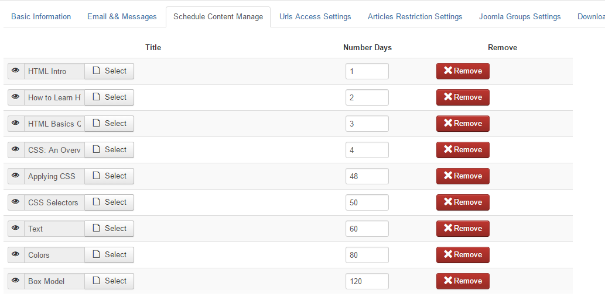
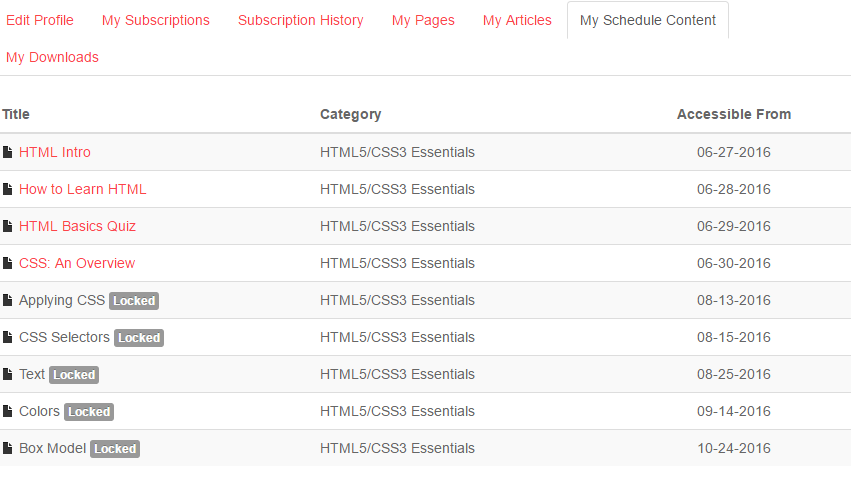

This plugin allows you to schedule releasing Joomla articles/content to subscribers base on number of days which they subscribed for your subscription plan. For example, on first day of the subscription, you allow them to access to the first 3 articles, the second days, you allow them to access to additional 2 articles and so on...

To use the plugin, please follow the steps below:
1. Go to Extensions -> Plugins Manager, find and publish the plugin **System - Membership Schedule Content**
2. Now, when you add, edit a subscription plan, there will be a new tab called **Schedule Content Manager** to allow you to select article and decide how many days from the date subscribers sign up for the plan they can access to that article 
3. Subscribers who subscribed for the subscription plan can access to his user profile page, go to **My Schedule Content** tab to see list of content articles which he can access. On the day he access to that page, if the content is accessible, the link to content will be clickable. If the content article is schedule to a future date, the link will not clickable, the system says that the content is locked and display the date which he can access to that article 