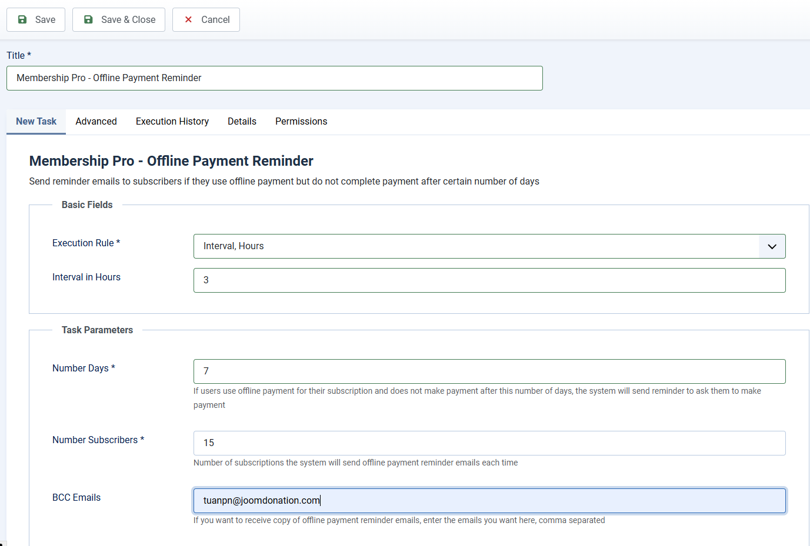

If you enable [**Offline Payment**](/basic-setup/payment-plugins/offline-payment) plugin to allow users to make payment for their subscriptions using Offline Payment method, you can use use this scheduled task to send emails to subscribers to remind them to make payment for their subscriptions if payment is not received after certain number of days:

1. Go to **System -> Plugins**, make sure **Task - Membership Pro** plugin is enabled.
2. Go to **System -> Scheduled Tasks**, press New button in the toolbar to create a new scheduled task for **Membership Pro - Offline Payment Reminder** task type.
3. Setup all required parameters, save it.

## Task Basic Fields
This scheduled task should be run several times per day. Each time it runs, it will send reminder to 10 - 20 subscribers, so you can setup **Basic Fields** to following values

- **Execution Rule**: Set to **Interval, Hours**
- **Interval in Hours**: Set to the number you want, for example, if you set it to 3, the task will be run every 3 hours.

## Task Parameters
- **Number Days**: Enter number of days into this parameter (for example, 7 days). Then if users choose to use offline payment and did not send payment to you within 7 days, the system will send reminder email to them.
- **Number Subscribers**: Control the number of subscribers which the system will send reminder emails to each time the task is run. You should not set to a too high number to avoid time out or reach server email sending limit per hours. Recommended value could be from 10 to 20 (15 should be enough).
- **BCC Emails**:  If you want to receive copy of the emails sent by this task schedule, enter emails you want here. Multiple emails are supported, just separate these emails by comma.

## Setup Email Subject and Email Body

Go to **Membership Pro -> Emails & Messages**, find and change the following message items to customize the subject and body of the email if needed:

- **offline_payment_reminder_email_subject**
- **offline_payment_reminder_email_body**