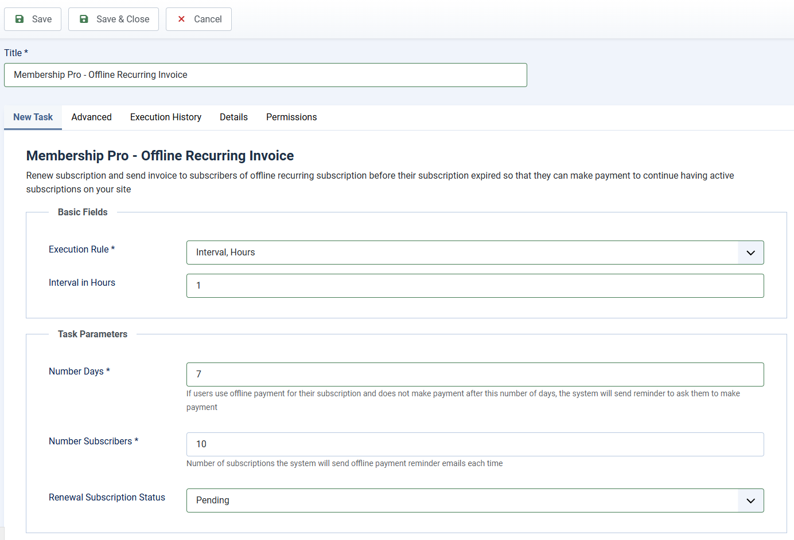

## When you need to use this scheduled task
This scheduled task can be used if you:
- Have recurring subscription plans on your site.
- You allow users to use offline payment method to sign up for these recurring subscription plans.

## How does it work
Each time the scheduled task runs, it will find recurring subscription records use offline which will be expired in the next 10 days (Number of days can be configured in plugin parameter) and:
- Create a renewal subscription record with Pending subscription status.
- Send an invoice (Pending status) to subscriber so that they know about this renewal and makes payment for the renewal manually (via bank transfer for example)
- After receiving payment for that renewal, administrator will approve/publish the renewal record to extend the active subscription for the subscriber.

## Create and configure the scheduled task

1. Go to **System -> Plugins** and make sure the **Task - Membership Pro** plugin is enabled.
2. Go to **System -> Scheduled Tasks** and click New in the toolbar. Select the **Membership Pro - Offline Recurring Invoice** task type.
3. Configure the required parameters and save the task.

## Task Basic Fields
This scheduled task should be run several times per day. Each time it runs, it will send reminder to 10 - 20 subscribers, so you can setup **Basic Fields** to following values

- **Execution Rule**: Set to **Interval, Hours**
- **Interval in Hours**: Set to the number you want, for example, if you set it to 1, the task will be run every 1 hour.

## Task Parameters
- **Number Days**: Enter number of days into this parameter (for example, 7 days). Then if users choose to use offline payment and did not send payment to you within 7 days, the system will send reminder email to them.
- **Number Subscribers**: Control the number of subscribers which the system will renew and send invoice to each time the task is run. You should not set to a too high number to avoid time out or reach server email sending limit per hours. Recommended value is 10.
- **Renewal Subscription Status**: Control the status of the renewal subscription record created by the system. You should set it to Pending and change status of the renewal record to Active when you actually received payment for the renewal from subscriber.

## Setup Email Subject and Email Body

Go to **Membership Pro -> Emails & Messages**, find and change the following message items to customize the subject and body of the email if needed:

- **offline_recurring_email_subject**
- **offline_recurring_email_body**