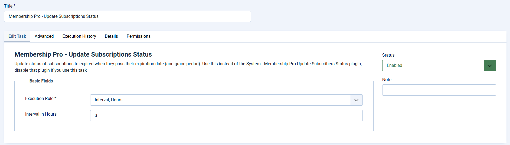

This task marks subscriptions as expired after their expiration date and grace period have passed. If you use this task, disable the [System - Membership Pro Update Subscribers Status plugin](/plugins/update-subscribers-status).

1. Go to **System -> Plugins** and make sure the **Task - Membership Pro** plugin is enabled.
2. Go to **System -> Scheduled Tasks** and click New in the toolbar. Select the **Membership Pro - Update Subscriptions Status** task type.
3. Configure the required parameters and save the task.

## Task Basic Fields
This scheduled task should be run several times per day. Each time it runs, it will send reminder to 10 - 20 subscribers, so you can setup **Basic Fields** to following values

- **Execution Rule**: Set to **Interval, Hours**
- **Interval in Hours**: The value of this parameter depends on your estimation about how many subscriptions will be expired per day. Each time the scheduled task run, it will update status of maximum 20 subscriptions. Set this parameter to 1 hour for example, in a day, it will be able to update about 24 x 20 = 480 subscriptions and it will be more than enough. If you have small number of subscriptions expires per day, reduce this to 2, 4 6 or more hours...if needed. In general, set it to 1 or 2 hours would be OK for almost all sites. 

