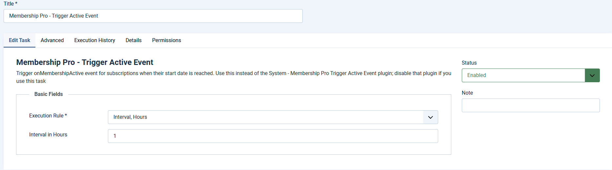

This task triggers **onMembershipActive** for subscriptions with a future **Subscription Start Date**. Use it for plans whose **Subscription Start Date Option** is set to **Fixed Date**, or to **Determine By Customer** if the customer selects the start date from a Date custom field. See **[Advanced Subscription Start Date](/basic-setup/plans/advanced-subscription-start-date)** for more information.

If you use this task, disable the **System - Membership Pro Trigger Active Event** plugin.

1. Go to **System -> Plugins** and make sure the **Task - Membership Pro** plugin is enabled.
2. Go to **System -> Scheduled Tasks** and click New in the toolbar. Select the **Membership Pro - Trigger Active Event** task type.
3. Configure the required parameters and save the task.

## Task Basic Fields
This scheduled task should be run several times per day. Each time it runs, it process 20 subscriptions, so you can setup **Basic Fields** to following values

- **Execution Rule**: Set to **Interval, Hours**
- **Interval in Hours**: The value of this parameter depends on your estimation about how many subscriptions will be expired per day. Each time the scheduled task run, it will update status of maximum 20 subscriptions. Set this parameter to 1 hour for example, in a day, it will be able to process about 24 x 20 = 480 subscriptions and it will be more than enough. If you have small number of subscriptions expires per day, reduce this to 2, 4 6 or more hours...if needed. In general, set it to 1 or 2 hours would be OK for almost all sites. 

