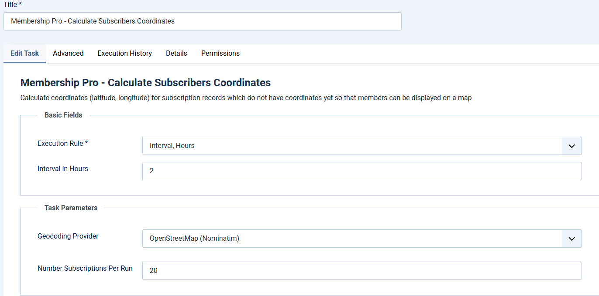

This scheduled task is used to calculate coordinates of subscriptions based on the address data of that subscription record, store the coordinates for the subscription so that members can be displayed on a map. You need to use this scheduled task if you want to display members on a map, see **[Display Members List](/frontend-items/display-members-list)** for more information and have subscription records created before enabling map on the menu item parameters.

1. Go to **System -> Plugins** and make sure the **Task - Membership Pro** plugin is enabled.
2. Go to **System -> Scheduled Tasks** and click New in the toolbar. Select the **Membership Pro - Calculate Subscribers Coordinates** task type.
3. Configure the required parameters and save the task.

Please note that this scheduled task is only used to calculate coordinates of subscriptions created before the scheduled task is created. For new subscriptions, it will calculate automatically by Membership Pro when the subscription created (by enabling Calculate Coordinates parameter in **System - Membership Pro** plugin. So once the task created, you just need to leave it to run for few days to calculate coordinates for existing subscriptions, and then you can disable it.

## Task Basic Fields
This scheduled task should be run several times per day. Each time it runs, it will send reminder to 10 - 20 subscribers, so you can setup **Basic Fields** to following values

- **Execution Rule**: Set to **Interval, Hours**
- **Interval in Hours**: The value of this parameter depends on your estimation about how many subscriptions will be expired per day. Each time the scheduled task run, it will process maximum 20 subscriptions. Set this parameter to 1 hour for example, in a day, it will be able to update about 24 x 20 = 480 subscriptions and it will be more than enough. In general, set it to 1 or 2 hours would be OK for almost all sites. 

