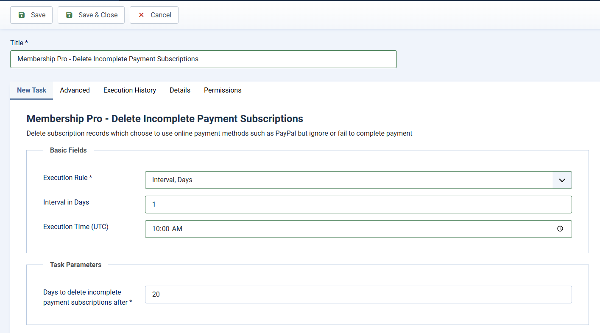

This task removes subscription records after a configurable number of days when the subscriber selected an online payment method such as PayPal or Stripe and failed to complete payment. This includes payments that fail or are abandoned. Deleting the records frees up database space.

## Create and configure the scheduled task

1. Go to **System -> Plugins** and make sure the **Task - Membership Pro** plugin is enabled.
2. Go to **System -> Scheduled Tasks** and click New in the toolbar. Select the **Membership Pro - Delete Incomplete Payment Subscriptions** task type.
3. Configure the required parameters and save the task.

## Task Basic Fields
This scheduled task does not need to run so often. It could be run every few days, for example, every 3 days, so you can setup **Basic Fields** to following values

- **Execution Rule**: Set to **Interval, Days**
- **Interval in Days**: Set to the number you want, for example, if you set it to 3, the task will be run every 3 days.
- **Execution Time (UTC)**: Choose the time you want the task to be executed, for example 10:00 

## Task Parameters
- **Days to delete incomplete payment subscriptions after**: Enter the number of days to keep unpaid subscription records. For example, enter 10 to delete records older than 10 days each time the task runs.