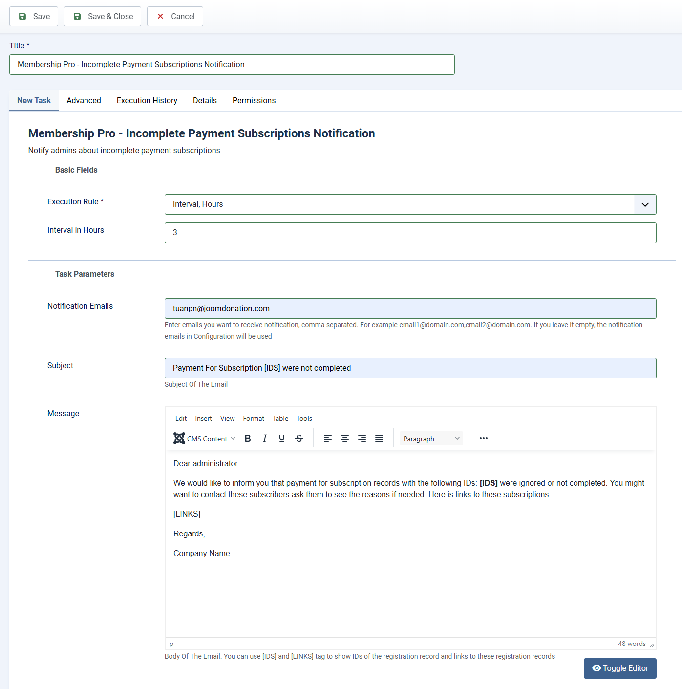

This task notifies administrators about subscriptions for which the subscriber selected an online payment method such as PayPal or Stripe but did not complete payment. This includes payments that fail or are abandoned. Administrators can follow up with those subscribers if needed.

## Create and configure the scheduled task

1. Go to **System -> Plugins** and make sure the **Task - Membership Pro** plugin is enabled.
2. Go to **System -> Scheduled Tasks** and click New in the toolbar. Select the **Membership Pro - Incomplete Payment Subscriptions Notification** task type.
3. Configure the required parameters and save the task.

## Task Basic Fields
This scheduled task should be run every few hours. So you can setup **Basic Fields** to following values

- **Execution Rule**: Set to **Interval, Hours**
- **Interval in Hours**: Set to the number you want, for example, if you set it to 3, the task will be run every 3 hours.

## Task Parameters
- **Notification Emails**: Enter the email addresses that should receive notifications about incomplete payments. Separate multiple addresses with commas.
- **Subject**: Subject of the email. You can use [IDS] tag and it will be replaced with IDs of the incomplete payment subscriptions. For example: **Payment For Subscription [IDS] were not completed**
- **Message**: Enter the body of the email. You can use the [IDS] and [LINKS] tags as shown in the example below.

Dear administrator

We would like to inform you that payment for subscription records with the following IDs: [IDS] were ignored or not completed. You might want to contact these subscribers ask them to see the reasons if needed. Here is links to these subscriptions:

[LINKS]

Regards,

Company Name