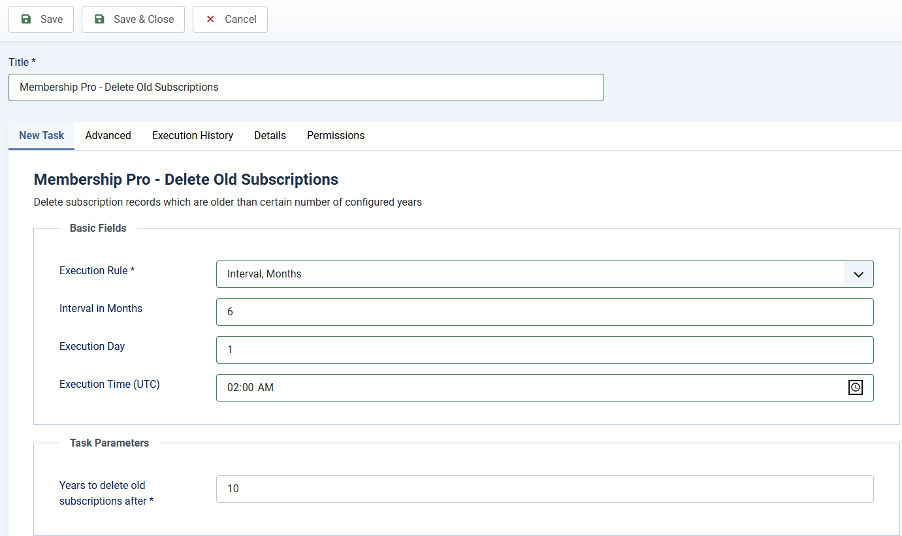

This task deletes subscriptions older than the configured Number Of Years (10 years by default). Most sites do not need this task. Follow these steps if you need to use it.

## Create and configure the scheduled task

1. Go to **System -> Plugins** and make sure the **Task - Membership Pro** plugin is enabled.
2. Go to **System -> Scheduled Tasks** and click New in the toolbar. Select the **Membership Pro - Delete Old Subscriptions** task type.
3. Configure the required parameters and save the task.

## Task Basic Fields
This scheduled task should not be run so often. Run it every few days should be enough. So you can setup **Basic Fields** to following values

- **Execution Rule**: Set to **Interval, Months**
- **Interval in Months**: Set to the number you want, for example, if you set it to 3, the task will be run every 3 months.
- **Execution Day**: Choose the day in month you want the task to be executed (for example, set it to 1 and it will be run on the first day of month)
- **Execution Time (UTC)**: Choose the time in the day the task will be executed, for example 10:00 AM.

## Task Parameters
- **Years to delete old subscriptions after**:  Enter a number here (for example 10) and subscription records older than that number of years will be deleted each time the task is executed.