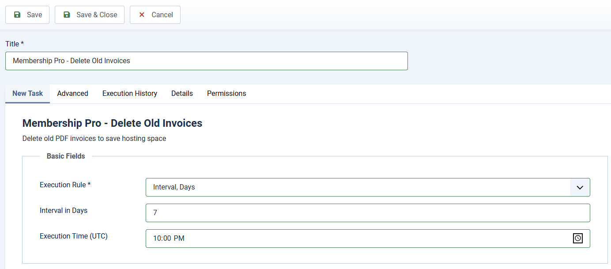

Membership Pro stores each generated invoice PDF on your server. To save hosting space, this task deletes invoice PDFs more than one day old each time it runs.

## Create and configure the scheduled task

1. Go to **System -> Plugins** and make sure the **Task - Membership Pro** plugin is enabled.
2. Go to **System -> Scheduled Tasks** and click New in the toolbar. Select the **Membership Pro - Delete Old Invoices** task type.
3. Configure the required parameters and save the task.

## Task Basic Fields
This scheduled task should not be run so often. Run it every few days should be enough. So you can setup **Basic Fields** to following values

- **Execution Rule**: Set to **Interval, Days**
- **Interval in Days**: Set to the number you want, for example, if you set it to 7, the task will be run every 7 days.
- **Execution Time (UTC)**: Choose the time in the day the task will be executed, for example 10:00 AM.