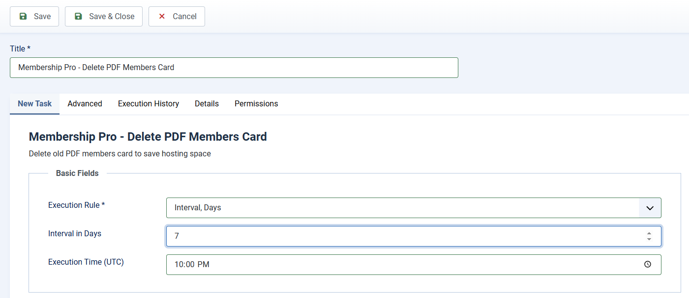

Each time Membership Pro generates PDF member card, a PDF file for that member card will be generated and stored on server and costs hosting space. This scheduled task is used to delete member card PDFs which are older than one day each time it is executed. To use this feature:

## Create and configure the scheduled task

1. Go to **System -> Plugins**, make sure **Task - Membership Pro** plugin is enabled.
2. Go to **System -> Scheduled Tasks**, press New button in the toolbar to create a new scheduled task for **Membership Pro - Delete PDF Members Card
** task type.
3. Setup all required parameters, save it.

## Task Basic Fields
This scheduled task should not be run so often. Run it every few days should be enough. So you can setup **Basic Fields** to following values

- **Execution Rule**: Set to **Interval, Days**
- **Interval in Days**: Set to the number you want, for example, if you set it to 7, the task will be run every 7 days.
- **Execution Time (UTC)**: Choose the time in the day the task will be executed, for example 10:00 AM.