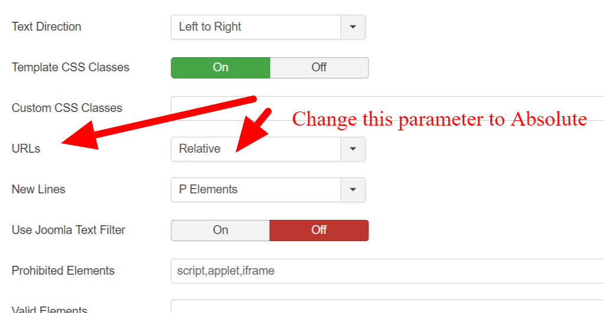

Sometime, you entered a URL into the email message. However, when users receive the email, that URL is not accessible. The reason is because when the message is saved, the editor which you are using will convert that **absolute URL** to become **relative URL**, and it causes the error.

To solve the error, you need to go to Extensions -> Plugins, find the plugin you are using (for example, Tiny MCE). Click on the plugin to edit, there is a parameter called **URLs**. By default, it's **Relative**. Change it to **Absolute**, then edit the email message, save it again and the issue should be sorted.

Attached in screenshot of Tiny MCE editor plugin, if you use a different editor plugin (like JCE), there should be similar parameter which controls this behavior.

